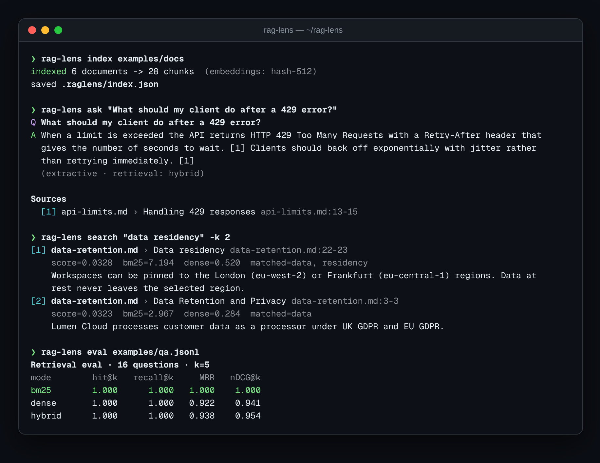

<div align="center">

# 🔎 rag-lens

**Retrieval-augmented Q&A over your local docs — BM25 + optional embeddings, cited answers, and a retrieval-quality eval you can gate CI on.**

[](https://github.com/hbtabi/rag-lens/actions/workflows/ci.yml)


-412991?logo=openai&logoColor=white)

[](LICENSE)

</div>

Most RAG demos are a black box: text goes in, a confident paragraph comes out, and you have no idea whether
retrieval actually worked. **rag-lens** puts a lens on every step. It shows *which* chunks were retrieved,
*why* (BM25 score, dense similarity, matched terms), cites every sentence back to a file and line range, and
ships an evaluation command that measures hit rate, recall, MRR and nDCG so retrieval changes are measurable.

It runs **fully offline** — BM25 plus a feature-hashing embedder and an extractive answerer — and upgrades
to **any OpenAI-compatible API** (OpenAI, Ollama, LM Studio, vLLM, Groq…) for embeddings and generated answers.

## 📸 Demo

<p align="center"></p>

## ✨ Features

- **Heading-aware chunking** of Markdown / text: chunks never cross a section, keep line ranges for citations, and fenced code is never mistaken for a heading
- **BM25 from scratch** on an inverted index with a tiny stemmer — no search engine required
- **Dense retrieval, two ways**: an offline signed feature-hashing embedder (words, bigrams, char 4-grams) or any `/embeddings` API
- **Hybrid search** with Reciprocal Rank Fusion, plus `--explain` score breakdowns for every hit
- **Cited answers**: offline extractive answers with `[n]` citations, or LLM answers constrained to the context with citation parsing and an "I don't know" path
- **Graceful fallback**: if the API errors or no key is set, you still get an offline answer
- **Retrieval eval**: `hit@k`, `recall@k`, `MRR`, `nDCG@k` across bm25 / dense / hybrid from a JSONL file, with `--min-hit` to fail CI on regressions
- **Persistent JSON index**, `--json` output for scripting, and a standard-library HTTP client (NumPy is the only dependency)

## 🚀 Quick start

```bash
git clone https://github.com/hbtabi/rag-lens.git && cd rag-lens
python -m venv .venv && source .venv/bin/activate
pip install -e ".[dev]"

rag-lens index examples/docs                       # chunk + index (offline hashing embeddings)
rag-lens ask "What happens when I hit my spending cap?"
rag-lens search "data residency" -k 3            # ranked chunks + score breakdown
rag-lens eval examples/qa.jsonl                    # compare bm25 / dense / hybrid
```

Point it at your own folder with `rag-lens index ~/notes` or skip the saved index with `--docs ~/notes`.

### Using an LLM (optional)

```bash
cp .env.example .env   # then export the variables, or set them in your shell
export OPENAI_API_KEY=sk-...
export OPENAI_BASE_URL=https://api.openai.com/v1   # or http://localhost:11434/v1 for Ollama
rag-lens index examples/docs --embeddings api
rag-lens ask "Which identity providers work with SSO?" --llm --explain
```

| Variable | Default | Purpose |
| --- | --- | --- |
| `OPENAI_API_KEY` | – | Enables `--llm` and `--embeddings api` |
| `OPENAI_BASE_URL` | `https://api.openai.com/v1` | Any OpenAI-compatible server |
| `RAGLENS_CHAT_MODEL` | `gpt-4o-mini` | Model for generated answers |
| `RAGLENS_EMBED_MODEL` | `text-embedding-3-small` | Model for API embeddings |

## 📏 Evaluating retrieval

An eval file is JSONL with a question and the documents (or `doc#Heading` sections) that should be retrieved:

```json
{"question": "What does SEV1 mean?", "relevant": ["incidents.md#Severity levels"]}
```

```bash
rag-lens eval examples/qa.jsonl -k 5 --min-hit 0.9   # exits 2 if hybrid hit@5 < 0.9
rag-lens eval examples/qa.jsonl --json               # machine-readable metrics
```

The bundled example corpus is a fictional cloud provider's documentation (`examples/docs`) with 16 labelled questions.

## 🐍 Library use

```python
from raglens import Answerer, Retriever, load_corpus
from raglens.embeddings import HashingEmbedder

retriever = Retriever(load_corpus("examples/docs"), embedder=HashingEmbedder())
answer = Answerer(retriever, k=4).ask("How long are logs kept on the Team plan?")
print(answer.text)
for c in answer.citations:
    print(c.number, c.location, c.heading)
```

## 🗂️ Project structure

```
rag-lens/
├── src/raglens/
│   ├── loader.py       # heading-aware chunking with line ranges
│   ├── text.py         # tokeniser, stopwords, light stemmer, sentence splitter
│   ├── bm25.py         # Okapi BM25 over an inverted index
│   ├── embeddings.py   # feature-hashing + OpenAI-compatible embedders
│   ├── retriever.py    # bm25 / dense / hybrid (RRF) search, explanations, JSON index
│   ├── answer.py       # extractive + LLM answerers with citations
│   ├── evaluate.py     # hit@k, recall@k, MRR, nDCG@k
│   ├── llm.py          # stdlib OpenAI-compatible client
│   └── cli.py          # index | search | ask | eval
├── examples/docs/      # sample corpus
├── examples/qa.jsonl   # labelled eval questions
├── tests/              # pytest suite
└── .github/workflows/ci.yml
```

## 🧪 Development

```bash
pytest          # unit + CLI tests
ruff check .    # lint
```

CI runs lint, tests and the retrieval quality gate on Python 3.10–3.13.

## 🛣️ Roadmap

- [ ] PDF and HTML loaders
- [ ] Cross-encoder re-ranking stage (optional local model)
- [ ] Incremental re-indexing based on file hashes
- [ ] Answer-faithfulness eval (does each cited passage support its sentence?)
- [ ] Small web UI for exploring retrieval traces

## 📄 Licence

[MIT](LICENSE) © 2026 Mohammed Hassan bin Tayyeb · Built by [Hasenix](https://github.com/hbtabi) in London.
